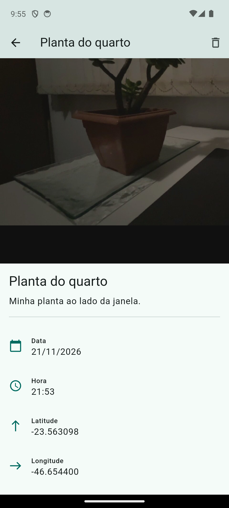
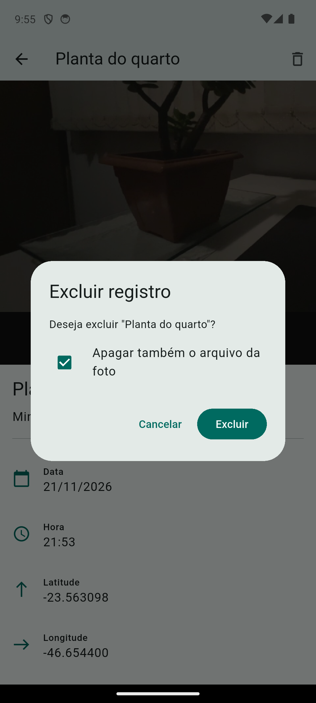

# GeoDiário

Aplicativo Flutter para registrar fotografias com **data, hora e localização GPS** associadas automaticamente. Cada registro recebe um título e uma descrição curta, e fica salvo localmente: a foto no armazenamento do aparelho, os dados num banco **SQLite** (`sqflite`).

Atividade prática da disciplina **Desenvolvimento de Dispositivos Móveis**.

## Funcionalidades implementadas

| Requisito | Como foi implementado |
|---|---|
| **RF01 – Captura de fotografia** | Botão **Novo registro** → **Tirar foto** abre a câmera do aparelho (`image_picker`, `ImageSource.camera`). Dá para refazer a foto antes de salvar. |
| **RF02 – Informações do registro** | A **data e hora** são gravadas no momento em que a foto é tirada. Em seguida o app busca **latitude e longitude** no GPS (`geolocator`), conferindo se o serviço está ativo e pedindo a permissão. Se a localização falhar, o app mostra o motivo e o botão **Tentar de novo**. O usuário informa um **título** (obrigatório) e uma **descrição** (opcional). |
| **RF03 – Armazenamento local** | A foto é copiada da pasta temporária da câmera para a pasta de documentos do app (`path_provider`), em `fotos/`. O banco SQLite guarda o **caminho** desse arquivo e as demais informações. |
| **RF04 – Consulta dos registros** | A tela inicial é uma **galeria** (`GridView`) com miniatura, título e data/hora, do registro mais recente para o mais antigo. Puxar para baixo recarrega a lista. |
| **RF05 – Visualização e exclusão** | Tocar num card abre os **detalhes**: foto, título, descrição, data, hora, latitude e longitude. O ícone de lixeira pede confirmação e exclui o registro do banco; a caixa **Apagar também o arquivo da foto** (marcada por padrão) remove o arquivo de imagem do aparelho. |

Operações de banco implementadas: **inclusão** (`insert`), **consulta** (`query`) e **exclusão** (`delete`).

## Bibliotecas utilizadas

| Pacote | Uso |
|---|---|
| [`image_picker`](https://pub.dev/packages/image_picker) | Captura da foto pela câmera (e recuperação da foto se o Android encerrar o app com a câmera aberta). |
| [`geolocator`](https://pub.dev/packages/geolocator) | Verificação do serviço de localização, permissões e leitura da latitude/longitude. |
| [`sqflite`](https://pub.dev/packages/sqflite) | Banco de dados SQLite local. |
| [`path`](https://pub.dev/packages/path) | Montagem dos caminhos do banco e dos arquivos de foto. |
| [`path_provider`](https://pub.dev/packages/path_provider) | Pasta de documentos do app, onde as fotos ficam guardadas. |
| [`provider`](https://pub.dev/packages/provider) | Gerenciamento de estado (`ChangeNotifier` + `ChangeNotifierProvider`). |
| [`sqflite_common_ffi`](https://pub.dev/packages/sqflite_common_ffi) *(dev)* | Roda o SQLite nos testes automatizados, no computador. |

## Estrutura da tabela SQLite

Banco `geodiario.db`, tabela `registros`:

```sql
CREATE TABLE registros(
  id INTEGER PRIMARY KEY AUTOINCREMENT,
  titulo TEXT NOT NULL,
  descricao TEXT,
  caminho_foto TEXT NOT NULL,
  data_hora TEXT NOT NULL,
  latitude REAL NOT NULL,
  longitude REAL NOT NULL
)
```

| Coluna | Tipo | Descrição |
|---|---|---|
| `id` | `INTEGER` (PK, autoincremento) | Identificador gerado pelo SQLite. `AUTOINCREMENT` evita reaproveitar o id de um registro excluído. |
| `titulo` | `TEXT` | Título informado pelo usuário (obrigatório). |
| `descricao` | `TEXT` | Descrição breve (opcional). |
| `caminho_foto` | `TEXT` | Caminho do arquivo da foto no armazenamento local do app. |
| `data_hora` | `TEXT` | Data e hora da captura em ISO 8601 (ex.: `2026-11-20T14:05:32.000`). |
| `latitude` | `REAL` | Latitude obtida pelo GPS. |
| `longitude` | `REAL` | Longitude obtida pelo GPS. |

## Organização do código

```
lib/
├── main.dart                     # MaterialApp + MultiProvider
├── models/registro.dart          # Modelo Registro (toMap / fromMap)
├── data/database_helper.dart     # SQLite: criação da tabela, insert, query, delete
├── services/
│   ├── photo_service.dart        # Câmera e arquivos das fotos
│   └── location_service.dart     # GPS e permissões de localização
├── provider/registros.dart       # Estado da lista (ChangeNotifier)
├── views/
│   ├── registro_list.dart        # Galeria (RF04)
│   ├── registro_form.dart        # Novo registro (RF01, RF02, RF03)
│   └── registro_detail.dart      # Detalhes e exclusão (RF05)
├── components/
│   ├── registro_card.dart        # Card da galeria
│   └── info_linha.dart           # Linha ícone + rótulo + valor
└── utils/formatadores.dart       # Formatação de data, hora e coordenadas
test/registro_test.dart           # Testes do modelo e do banco (inclusão, consulta, exclusão)
```

## Permissões

- **Android** (`android/app/src/main/AndroidManifest.xml`): `CAMERA`, `ACCESS_FINE_LOCATION`, `ACCESS_COARSE_LOCATION`.
- **iOS** (`ios/Runner/Info.plist`): `NSCameraUsageDescription`, `NSPhotoLibraryUsageDescription`, `NSLocationWhenInUseUsageDescription`.

## Capturas de tela

| Galeria | Novo registro | Detalhes | Exclusão |
|---|---|---|---|
|  |  |  |  |

## Como executar

```bash
flutter pub get
flutter run          # com um celular Android conectado (depuração USB) ou emulador
flutter test         # testes do modelo e do banco SQLite
```

Para testar o GPS no emulador, defina uma posição em *Extended controls → Location*.
